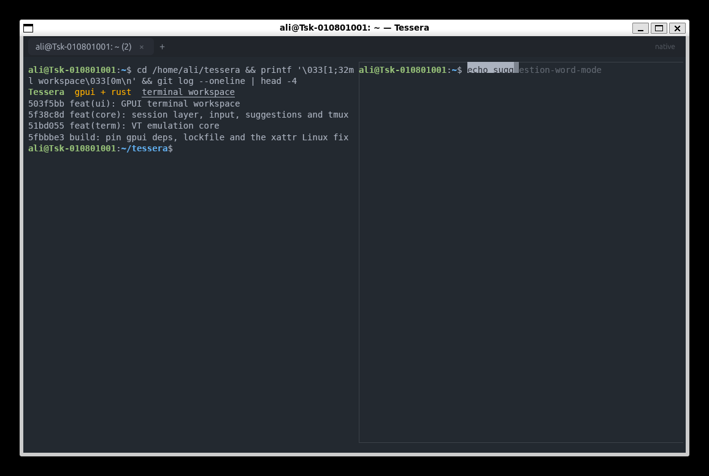

# Tessera

[](https://github.com/mrsase/tessera/actions/workflows/ci.yml)

A GPU-accelerated terminal **workspace** written in Rust, built on [GPUI](https://gpui.rs)
(Zed's UI framework): tabs, native split panes, an optional tmux backend for
persistent sessions, and inline history suggestions.



Named after the small tiles a mosaic is built from.

## Features

- **Tabs and split panes** — a binary layout tree with ratios, arbitrary nesting,
  per-pane focus, pane zoom, and click/drag selection with copy/paste.
- **Real terminal emulation** — own VT core (`vte` frames the bytes, Tessera owns
  the semantics): 16/256/truecolor SGR, scroll regions, alternate screen
  (47/1047/1049), DECSCUSR cursor shapes, wide cells, DEC line drawing, OSC 0/2
  titles, OSC 7 cwd, 5000 lines of scrollback, DSR/DA replies.
- **tmux as a first-class backend** — windows map to tabs, tmux panes to split
  panes; sessions survive quitting Tessera, and attaching to an existing session
  replays each pane's screen and scrollback. Falls back to native PTYs where tmux
  is unavailable.
- **History autosuggestions** — zsh-autosuggestions-style ghost text ranked by
  frecency, recency and working directory, fed by `~/.bash_history`,
  `~/.zsh_history` and a JSONL log written by the shell integration. Accept with
  `→`, a word with `Ctrl+→`, dismiss with `Esc`.
- **Command palette and scrollback search** — `Ctrl+Shift+P` / `Ctrl+Shift+F`,
  fuzzy filtering, keyboard- and mouse-driven, rename tabs with `F2`.
- **Keyboard-first** — usual terminal keys (Ctrl+C/D/L/R/Z, Alt+B/F, F-keys) go to
  the child; app shortcuts stay out of the way. Full map in
  [`docs/keys.md`](docs/keys.md).
- **Configurable** — TOML config for backend, shell, font, palette and
  suggestions.

## Quick start

Linux needs a Vulkan driver and the X11/Wayland development packages:

```sh
sudo apt-get install -y libxkbcommon-dev libxkbcommon-x11-dev \
  libwayland-dev libvulkan-dev libx11-xcb-dev libxcb1-dev
cargo run -p tessera-ui --release
```

macOS needs Xcode command-line tools; Windows needs the MSVC build tools. GPUI's
text system only accepts runtime font registration on Linux, so the embedded
DejaVu Sans Mono is used there and the system mono font elsewhere.

Configuration lives at `~/.config/tessera/config.toml` (XDG respected):

```toml
backend = "auto"          # auto | native | tmux
shell = "/bin/zsh"        # default: $SHELL
history_suggestions = true
scrollback = 5000
font_family = "DejaVu Sans Mono"
font_size = 14.0

[theme]
foreground = "#abb2bf"
background = "#282c34"
cursor = "#abb2bf"
selection = "#3e4451"
# palette = [16 hex colours]
```

### Shell integration (recommended for suggestions)

```sh
# bash
echo '[ -f /path/to/tessera/scripts/tessera.bash ] && source /path/to/tessera/scripts/tessera.bash' >> ~/.bashrc
# zsh
echo '[ -f /path/to/tessera/scripts/tessera.zsh ] && source /path/to/tessera/scripts/tessera.zsh' >> ~/.zshrc
```

The scripts emit OSC 133 prompt markers, report the working directory with
OSC 7, and append executed commands to
`~/.local/share/tessera/history.jsonl`. Suggestions also work without them by
reading the shells' own history files.

### tmux mode

`backend = "auto"` uses tmux when the binary is present, native PTYs otherwise.
`"tmux"` makes tmux mandatory. Quitting detaches the control client, leaving the
session alive; reattaching restores panes via `capture-pane`. `"native"` keeps
everything in-process (the only choice on Windows).

## Keymap

| Chord | Action |
|---|---|
| `Ctrl+Shift+T` / `Ctrl+Shift+W` | new tab / close pane (tab when last) |
| `Ctrl+Tab`, `Ctrl+1…9` | cycle / select tabs |
| `Ctrl+Shift+E` / `Ctrl+Shift+O` | split right / split down |
| `Ctrl+Shift+Arrows` | move pane focus |
| `Ctrl+Shift+Z` | zoom pane |
| `Ctrl+Shift+C` / `Ctrl+Shift+V` | copy selection / paste |
| `Shift+PgUp` / `Shift+PgDn` | scrollback |
| `Ctrl+Shift+P` / `Ctrl+Shift+F` | palette / scrollback search |
| `F2` | rename tab |
| `Ctrl+Shift+Plus/Minus/0` | font size |

## Architecture

```
crates/tessera-term   VT parser, grid, scrollback, attrs (no I/O, no pixels)
crates/tessera-core   Mux trait + layout tree, native PTY backend, tmux backend,
                      history index, input encoding, shortcuts, config, selection
crates/tessera-ui     GPUI app: tab bar, pane canvas, ghost text, palette
scripts/              bash/zsh integration
docs/                 architecture, keymap, screenshot
```

The UI never mutates a terminal from a reader thread: backends enqueue bytes and
wake the UI; a single `poll()` applies them. Panes are painted by one custom
canvas element per pane (shaped rows, background quads, cursor, ghost text), with
geometry derived from integer cell metrics so mouse hit-testing and text agree.
See [`docs/architecture.md`](docs/architecture.md) for the contracts and the
trade-offs (including why `xattr` is vendored).

## Platform support

| Target | Core crates | GPUI UI |
|---|---|---|
| Linux x86_64/aarch64 | yes | yes — verified here on WSLg/X11 with lavapipe |
| macOS arm64/x86_64 | yes | builds in CI; not runtime-tested here |
| Windows x86_64 | yes (ConPTY) | builds in CI; not runtime-tested here |
| Android | core crates are portable | no GPUI backend |

WSLg's Wayland compositor rejects gpui 0.2.2's connection (the X11/Xwayland path
works), so run with `WAYLAND_DISPLAY=` on WSLg.

## Development

```sh
cargo test --workspace      # 105 tests: emulation, sessions, tmux, suggestions, UI
cargo clippy --all-targets  # warning-clean
cargo fmt --all --check
```

CI runs the headless crates plus a UI build on Linux, macOS and Windows. tmux
tests self-skip on machines without tmux.

## Limitations

- No font fallback: missing glyphs (CJK, emoji) render as tofu; one monospace
  family only.
- No ligatures, IME preedit, sixel/kitty graphics, OSC 52 or mouse reporting to
  applications.
- Resize does not reflow wrapped lines.
- Ghost suggestions stop at the first line-editing key the terminal cannot see
  (arrows, completion, history recall) — the line is invalidated rather than
  guessed.
- tmux mode does not yet forward mouse reports and cannot capture output a pane
  produced while no client was attached beyond what `capture-pane` holds.

## License

MIT.
