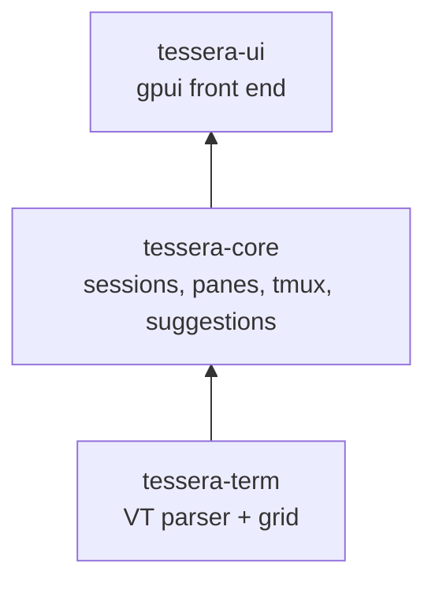

# Tessera architecture

## Goals

1. A terminal *workspace*: tabs, split panes, and durable sessions.
2. A UI built with GPUI (Zed's GPU UI framework), keyboard-first, configurable.
3. Emulation correctness in a layer that has no I/O and no pixels, so it can be
   tested everywhere and reused by any front end.
4. Run on Linux, macOS (x86_64 + arm64) and Windows. Android: the core crates
   are portable Rust with no UI assumptions; GPUI itself has no Android backend,
   so no Android UI is promised.
5. Session persistence and pane management delegated to tmux when available,
   with a native implementation as the portable fallback.

Non-goals: sixel/kitty graphics, ligatures, GPU text shaping beyond GPUI's, and
feature parity with iTerm2/Kitty. Correctness and a clean codebase beat breadth.

## Crate graph



`tessera-term` has no dependencies except `vte` and `unicode-width`.
`tessera-core` adds `portable-pty`, `async-channel`, `serde`/`toml`/`dirs`.
`tessera-ui` adds `gpui`. Tests for the first two run headlessly; UI smoke tests
require a GPU (or lavapipe).

## Emulation contract (`tessera-term`)

```rust
Term::new(cols, rows)
Term::feed(&mut self, bytes: &[u8])
Term::resize(&mut self, cols, rows)
Term::screen() -> &Screen            // active screen: rows, cursor, modes
Term::history() -> &VecDeque<Row>    // main-screen scrollback only
Term::line(abs: usize) -> Option<&Row> // absolute index across history+screen
Term::cols(), Term::rows(), Term::history_len()
Term::cwd() -> Option<&str>          // OSC 7
Term::title() -> &str
Term::alt_active(), Term::app_cursor(), Term::bracketed_paste()
Term::cursor_visible(), Term::cursor_blink(), Term::cursor_style()
Term::take_bell(), Term::take_responses()
```

`Screen` owns rows, cursor, scroll margins, origin mode and pending-wrap state;
`Row` owns cells plus a `wrapped` flag. `Cell` holds `char`, two symbolic
`Color`s, an `Attrs` bitfield and a wide-glyph continuation flag. The renderer
resolves colours, so palette changes never rewrite the grid.

Required behaviour is the same VT subset as `emulator-test` (the learning
prototype): C0/C1, CSI cursor/erase/insert/scroll/margins/tabs/SGR/modes,
DECSC/DECRC, DECSTBM, alternate screen 47/1047/1049, OSC 0/2 titles, DSR/DA
replies, wide cells and DEC special graphics. Additions for Tessera: OSC 7 cwd
tracking, `line()` helper, `history_len()`, and a documented `Resize` policy
(top-left anchored, no reflow).

## Multiplexing contract (`tessera-core::mux`)

The UI is written against one trait; native PTY panes and tmux panes are two
implementations.

```rust
pub type PaneId = u64;

pub enum SplitDir { Horizontal, Vertical }
pub enum Layout { Leaf(PaneId), Split { dir: SplitDir, ratio: f32, first: Box<Layout>, second: Box<Layout> } }

pub struct PaneInfo { id: PaneId, title: String, cwd: Option<PathBuf>, size: (usize, usize) }
pub struct TabInfo { id: u64, title: String, layout: Layout, active: PaneId, panes: Vec<PaneInfo> }
pub struct Snapshot { tabs: Vec<TabInfo>, active_tab: usize }

pub enum MuxEvent { Output(PaneId), Tabs, Exit }

pub trait Mux {
    fn snapshot(&self) -> Snapshot;
    fn term(&self, pane: PaneId) -> Option<&Term>;
    fn poll(&mut self) -> Vec<MuxEvent>;          // drain PTY/tmux queues
    fn wake(&self) -> async_channel::Receiver<()>; // UI async task
    fn write(&mut self, pane: PaneId, bytes: &[u8]);
    fn resize_client(&mut self, cols: usize, rows: usize);
    fn new_tab(&mut self, cwd: Option<&Path>);
    fn close_tab(&mut self, tab: u64);
    fn select_tab(&mut self, tab: u64);
    fn split(&mut self, pane: PaneId, dir: SplitDir) -> Option<PaneId>;
    fn close_pane(&mut self, pane: PaneId);
    fn focus_pane(&mut self, pane: PaneId);
    fn set_split_ratio(&mut self, tab: u64, path: &[bool], ratio: f32);
    fn shutdown(&mut self);
}
```

Rules:

- Bytes always go through `poll()` on the UI thread; reader threads only enqueue
  and wake. `Term` is never shared across threads.
- Layout is a binary tree. `SplitDir::Horizontal` means children are side by
  side (a vertical divider); ratios are clamped to `0.1..=0.9`.
- Sizes: leaves get `(cols, rows)` minus one cell per divider. Resizing the
  window resizes every pane's PTY and `Term`.
- Native panes: one `portable-pty` child per pane, `TERM=xterm-256color`,
  `COLORTERM=truecolor`, `$SHELL` or configured shell.
- tmux panes (unix only): one `tmux -C` client. Windows map to tabs, tmux panes
  map to `pane` splits, `%output` is unescaped into each pane's `Term`.
  `send-keys` carries input, `refresh-client -C` carries the client size.
  `tmux` is detected at runtime; when absent the UI offers native mode only.
- Killing a tab/pane closes its PTY (native) or sends `kill-pane`/`kill-window`
  (tmux). Leaving the app detaches tmux instead of killing the server.

## Suggestions

Zsh-autosuggestions semantics, implemented in the terminal instead of the
shell:

1. Track the *input line* in the UI: bytes sent since the last `Enter`/`Ctrl+C`,
   updated on printable input and backspace. Any use of arrows, history recall
   or tab completion invalidates the tracked line until the next prompt.
2. `suggest(prefix, cwd, limit)` ranks:
   - prefix matches first, then substring, then subsequence;
   - frecency (`count` × recency decay) within each class;
   - same-cwd commands get a bonus;
   - the prefix itself is never suggested.
3. Render the best suggestion as dim ghost text after the cursor (clearing the
   cells it covers). `→` at end-of-line, `Ctrl+→`, or `Ctrl+Space` accepts and
   sends the remainder; `Esc` dismisses for the current line.
4. History sources: `~/.bash_history`, `~/.zsh_history` (extended format) and
   `~/.local/share/tessera/history.jsonl` written by the shell integration
   (`{"cmd","cwd","ts"}` per executed command).

Shell integration (`scripts/tessera.bash`, `scripts/tessera.zsh`) emits OSC 133
prompt markers and OSC 7 cwd so the terminal knows when a prompt is active and
where it is, and appends executed commands to the JSONL history.

## GPUI front end

- `TesseraApp` root view owns `Box<dyn Mux>`, active tab, scroll offset,
  selection, suggestion state and the command palette.
- The terminal is a custom `Element`: background quads per run, text shaped per
  row with `window.text_system()`, glyph positions snapped to the cell grid,
  cursor and selection painted on top, ghost text in the suggestion colour.
- Rendering uses the configured monospace family with embedded DejaVu Sans
  Mono as a fallback when the platform lacks the family.
- Input goes through the same key encoder as the prototype (`input.rs`), with
  app shortcuts intercepted first (see `docs/keys.md`).
- PTY wake-ups are delivered by an `async_channel` receiver polled from a GPUI
  async task; the task calls `cx.notify()` and never blocks the UI thread.

## Platform matrix

| Target | Core crates | UI | Notes |
|---|---|---|---|
| Linux x86_64/aarch64 | yes | yes | X11/Wayland, Vulkan via `blade`; lavapipe works |
| macOS arm64/x86_64 | yes | yes | Metal |
| Windows x86_64/aarch64 | yes | yes | ConPTY through `portable-pty` |
| Android | yes (tested for compile) | no | GPUI has no Android backend; no promises |

## Risks and mitigations

- **GPUI is pre-1.0 and API-unstable.** Pin the exact version; keep terminal
  painting in one element so the rest of the app is portable.
- **tmux control mode is stringly-typed.** Parse events in one module, cover it
  with a headless test that drives a real tmux server.
- **Ghost text can desynchronize from the shell.** Invalidate aggressively on
  any non-text input; never accept a suggestion the user did not see.
- **Software Vulkan is slow.** Compact damage-free painting: rows are shaped
  once per frame, quads only for non-default backgrounds.
